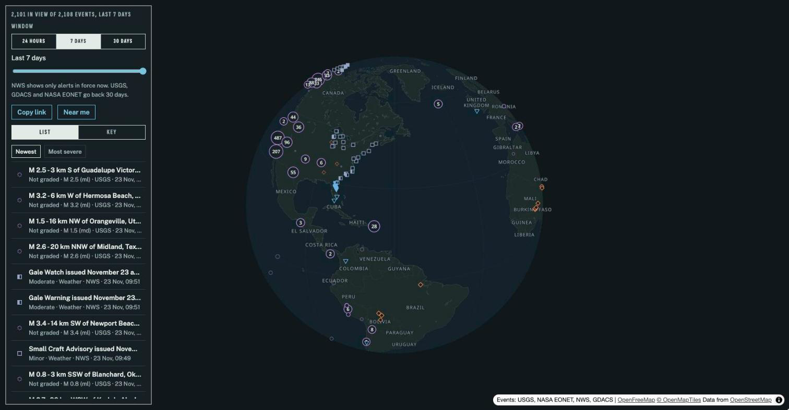

# SentryAtlas

**Real-time disaster monitoring, open and free.**

[](https://github.com/KOHANTIC/SentryAtlas/actions/workflows/ci.yml)
[](LICENSE)


SentryAtlas aggregates live disaster data from four public agencies and plots it on a single interactive map. Earthquakes, wildfires, floods, storms — see it all at a glance.

**[sentryatlas.com](https://sentryatlas.com)** · **[Open the map](https://sentryatlas.com/map/)**



## Architecture

One site and one API:

```
        sentryatlas.com                          map.sentryatlas.com
               │                                 /api and /health
   ┌───────────┴────────────┐            ┌──────────────┴───────────────┐
   │ Site: web/             │──fetch───▶ │ API: backend/ (Go)           │
   │ Next.js static export  │            │ DigitalOcean App Platform    │
   │ Cloudflare Workers     │            └──────────────┬───────────────┘
   └────────────────────────┘                           │ polls
                              ┌──────────┬──────────────┼─────────┐
                              │   USGS   │  NASA EONET  │   NWS   │  GDACS
                              └──────────┴──────────────┴─────────┘
```

- **API** (`backend/`): a Go server that polls the four sources on its own schedule, keeps each one's last good copy in memory, and serves it as v1 (`/api/v1/events`: GeoJSON, flat JSON or a stream) and v2 (`/api/v2/snapshot`, cached at the edge). It also runs the waiting list for location alerts.
- **Site** (`web/`): the home page, the map (MapLibre GL on a globe), a copy of it other sites can embed (`/embed/`), and the pages around them, built as plain files. Every design value comes from [`brand/`](brand/BRAND.md).
- **map.sentryatlas.com** keeps the API's address. Its other paths redirect to sentryatlas.com.

## Quick Start

### Prerequisites

- Go 1.27+
- Node.js 22+

### 1. The API

```bash
cd backend
go run ./cmd/server/
# Starts on http://localhost:8080; backend/.env.example lists its settings
```

### 2. The site

```bash
cd web
npm ci
NEXT_PUBLIC_API_BASE=http://localhost:8080 npm run dev
# Starts on http://localhost:3000, reading the local API
```

Without `NEXT_PUBLIC_API_BASE` the site reads the live API. The waiting-list form needs the API's `WAITLIST_ORIGINS` to include the site's origin.

## Project Structure

```
sentryatlas/
├── backend/                 # The Go API
│   ├── cmd/server/          # Entry point
│   ├── cmd/zones/           # Builds the NWS zone tables
│   └── internal/
│       ├── adapters/        # USGS, EONET, NWS, GDACS
│       ├── event/           # The v2 event model and its v1 projection
│       ├── group/           # One event reported by several sources
│       ├── handler/         # HTTP handlers
│       ├── mail/, waitlist/ # The waiting list and its email
│       ├── store/           # Each source's last good copy, and its poller
│       └── zones/           # NWS zone centers
├── web/                     # The site, sentryatlas.com
│   ├── src/app/             # Pages
│   ├── src/components/      # The map, panel, list and the rest
│   ├── src/lib/             # Data, filters, link state, tokens
│   └── e2e/                 # Playwright checks
├── brand/                   # BRAND.md, tokens.json, logo, their checks
├── docs/                    # API v2, data notes, design rounds, the cutover runbook
├── .do/app.yaml             # The API's App Platform spec
└── .github/                 # CI, the source and health checks, templates
```

## API

Free and without a key, from any site, 60 requests a minute from one address.

```bash
curl "https://map.sentryatlas.com/api/v2/snapshot?window=7d"
curl "https://map.sentryatlas.com/api/v1/events?types=earthquake&format=json&limit=10"
```

- **v2:** every current event in one snapshot (`?window=7d` or `30d`), and one event in full at `/api/v2/events/{id}`. [`docs/api/v2/README.md`](docs/api/v2/README.md) is the reference.
- **v1:** filtering by type, place and time, and a stream. [`backend/README.md`](backend/README.md) is the reference, with what v1 promises to keep.
- [sentryatlas.com/developers](https://sentryatlas.com/developers/) has the short version.

## Data Sources

| Source | Data | URL |
|--------|------|-----|
| USGS | Earthquakes | [earthquake.usgs.gov](https://earthquake.usgs.gov) |
| NASA EONET | Wildfires, volcanoes, storms, icebergs | [eonet.gsfc.nasa.gov](https://eonet.gsfc.nasa.gov) |
| NOAA / NWS | Floods, tornadoes, hurricanes, winter storms | [weather.gov](https://www.weather.gov) |
| GDACS | Cyclones, droughts, floods, volcanoes, earthquakes | [gdacs.org](https://www.gdacs.org) |
| NWS tsunami warning centers | Tsunami warnings, advisories, watches | [tsunami.gov](https://www.tsunami.gov) |

All are public and keyless.

Two optional map layers come from NOAA nowCOAST (radar, US) and NASA GIBS (satellite imagery), both public and keyless.

## Deployment

### The API

```bash
docker build -t sentryatlas-backend ./backend
docker run -p 8080:8080 sentryatlas-backend
```

In production it runs on DigitalOcean App Platform from [`.do/app.yaml`](.do/app.yaml), which deploys on every merge to `main`. A push does not apply the spec itself: a change to it, such as a new environment variable, is made in the DigitalOcean dashboard before the change that needs it is merged.

### The site

Cloudflare Workers static assets serves `web/`'s export ([`web/wrangler.jsonc`](web/wrangler.jsonc), headers in `web/public/_headers`). Workers Builds builds every push: `main` goes to sentryatlas.com, and each pull request gets a preview link. The operator's name and contact are build variables, `SITE_OPERATOR` and `SITE_PRIVACY_EMAIL`, set for production and previews.

[`docs/deploy/cutover.md`](docs/deploy/cutover.md) records how sentryatlas.com moved to it, the redirect rules for the old map host, and the way back.

### Cloudflare in front

Both hosts are on Cloudflare. App Platform does not cache responses from the API, and Cloudflare does not cache JSON on its own, so one Cache Rule makes it cache the v2 snapshot (`/api/v2/snapshot`), which says how long it may be kept:

- **Match:** `(http.request.uri.path eq "/api/v2/snapshot")`. The default cache key keeps the query string, so `window=7d` and `window=30d` are cached apart.
- **Cache eligibility:** Eligible for cache.
- **Edge TTL:** use the `Cache-Control` header if present, bypass the cache if not. The snapshot sends `public, max-age=30` with an ETag, so the edge keeps it 30 seconds, then revalidates with the API.
- **Browser TTL:** respect the origin's TTL. Otherwise the zone's default (4 hours) replaces `max-age=30` and browsers keep an old map.

Before its first polls the API answers the snapshot with `503` and `Cache-Control: no-store`, which this rule never caches. The SSE stream on `/api/v1/events` is outside the rule and passes through uncached.

To check it (the first request after 30 seconds reads `MISS` or `REVALIDATED`, the next `HIT`; a repeat with `If-None-Match` set to the ETag gets `304` from the edge):

```bash
curl -s -o /dev/null -D - "https://map.sentryatlas.com/api/v2/snapshot?window=7d" | grep -i -E "cf-cache-status|cache-control|age|etag"
```

To undo it, turn the rule off in the zone's Cache Rules; every request then reaches the API again (`cf-cache-status: DYNAMIC`).

## Contributing

Contributions are welcome! See [`CONTRIBUTING.md`](CONTRIBUTING.md) for guidelines, and [`SECURITY.md`](SECURITY.md) for reporting vulnerabilities.

## License

This project is licensed under the [GNU Affero General Public License v3.0](LICENSE).

---

Made by the [KOHANTIC](https://kohantic.com) team.
